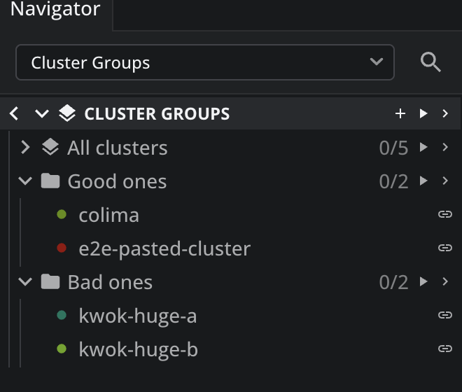
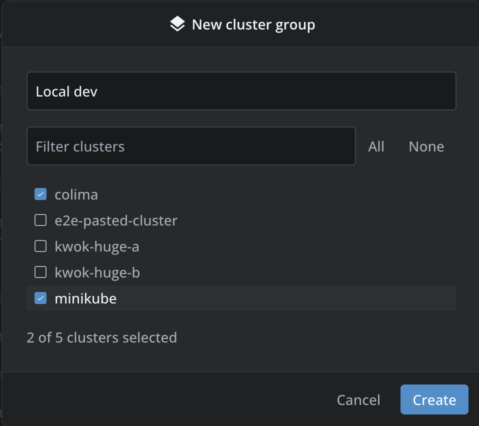
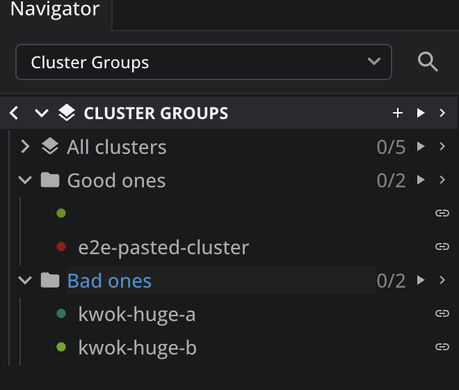

# @k8slens/cluster-groups

Cluster Groups adds a **Cluster Groups** branch to the Lens navigator. It lists every cluster you have, lets you sort them into groups of your own (Production, Staging, a customer's clusters…), and connects a whole group, or every cluster, in one click.

## Install

[Open Cluster Groups in Lens](https://app.k8slens.dev/lens-launcher?c=lens%3A%2F%2Fapp%2Fopen%2Fextension%3Fname%3D@k8slens/cluster-groups)

## Features

- **All clusters in one place**: the built-in *All clusters* group lists every cluster Lens knows, each with its colour or icon and its connection state.
- **Groups of your own**: put any clusters together in named groups. A cluster can be in as many groups as you like, and groups are kept across restarts.
- **Connect a group at once**: the ▶ button on a group connects every cluster in it that is not connected yet, up to four at a time. The button on *Cluster Groups* itself connects every cluster you have. A notification tells you how it went, and names any cluster that could not be connected.
- **Live status**: each group shows how many of its clusters are connected (`3/5`). Each cluster shows a spinner while it connects and a tick once it is connected.

## Usage

- **Create a group**: click **+** on the *Cluster Groups* row, or right-click it and choose **New group…**. Name the group and tick its clusters. The filter box narrows a long list.
- **Edit or delete a group**: right-click the group and choose **Edit group…** or **Delete group…**. Deleting a group never touches the clusters themselves.
- **Add a cluster to groups from anywhere**: right-click any cluster in the navigator and choose **Add to cluster groups…**. You can also type the name of a new group there, and it is created with that cluster in it.
- **Drag a cluster between groups**: drag a cluster by its name onto another group's name. Out of one of your groups it moves there; out of *All clusters* it is added and stays everywhere else it was. A group that can take the cluster lights up as you drag over it.
- **Remove a cluster from a group**: right-click the cluster inside the group and choose **Remove from group**.
- **Connect**: click ▶ on a group, or on *Cluster Groups* for everything, or the link button on a single cluster. The same actions are in each row's right-click menu.
- **Open a cluster**: click a cluster's name inside a group, or right-click it and choose **Open pods**. Lens connects the cluster if needed and shows its pods in all namespaces.
- **Command palette**: *Cluster Groups: Connect all clusters* and *Cluster Groups: New group*.

What changed in each version is in [CHANGELOG.md](./CHANGELOG.md).
